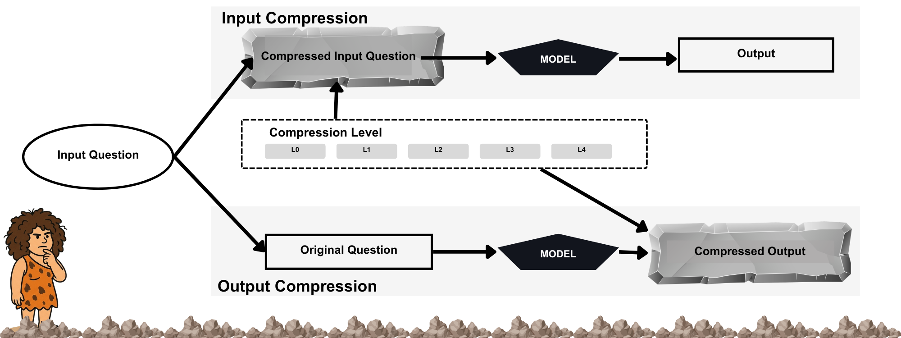

# CAVEWOMAN: How Large Language Models Behave Under Linguistic Input and Output Compression (EMNLP 2026)



*Paper: [alphaxiv.org/pdf/2606.24083v1](https://www.alphaxiv.org/pdf/2606.24083v1).* (EMNLP 2026 Main Track)

**Dataset:** model generations are released on Hugging Face at [rayascript/cavewoman-data](https://huggingface.co/datasets/rayascript/cavewoman-data).

CAVEWOMAN is a two-channel benchmark that measures what happens to model
accuracy when you strip language down to caveman register, either by
**compressing the prompt you send in** or by **constraining the response the
model writes back**, across five reduction levels (L0..L4).

## TL;DR

**Constrain the model's output. Don't compress your input.**

- Constraining the output is cheaper, about 1.5x on average and up to 3x, and
  accuracy holds until the constraint gets severe.
- Compressing your input does not save money and usually costs more. You save a
  few input tokens, the model answers at greater length, and output tokens are
  priced several times higher than input tokens.
- Cheaper and correct is not the same as faithful. Roughly half of correct
  answers under output compression no longer entail what the model would have
  said unconstrained.
- Measured on single-turn tasks with a short extractable answer. Long-form
  behaves differently.
- Cost figures assume you call the API directly and are billed per token.
  Through a product or subscription wrapper, the per-token math does not carry.

## Scale

| | |
|---|---:|
| Model generations | **1,280,850** |
| API calls | **573,250** |
| Local-GPU time | **425 GPU-hours** |
| Models run | **9** (4 open-weight + 5 commercial API) |
| Datasets | 8 |
| Semantic-fidelity metrics | 14+ |
| Accuracy validation | **4 human labelers + independent second LLM judge** |

Accuracy is adjudicated, not raw regex: anything the extractor cannot parse is
ruled on by an LLM judge, checked against a second judge (90.9% agreement) and
four human labelers. See [`analysis/stats/`](analysis/stats/).

## Quickstart

```bash
# 1. Install dependencies (Python 3.11+)
pip install -r requirements.txt
python -m spacy download en_core_web_sm

# 2. Configure API keys (only needed for API model runs)
cp .env.example .env   # then fill in OPENAI_API_KEY / ANTHROPIC_API_KEY

# 3. Run one cell, e.g. gpt-4o on GSM8K, output-constrained, L0
python experiments/run_experiment_api.py \
    --model gpt-4o \
    --dataset gsm8k \
    --condition output \
    --level L0 \
    --output_dir ./results/gpt4o_output/gsm8k

# 4. Score it
python evaluation/evaluate_results.py --results_dir ./results/gpt4o_output/gsm8k
```

## Pointing the scripts at your own results

Every analysis script reads a results tree laid out as:

```
<results_root>/<tag>_<condition>/<dataset>/caveman_<tag>_<dataset>_<condition>_<level>.jsonl
```

The default is this repo's `results/`. Redirect it either way:

```bash
python analysis/extraction_audit.py --results-root /path/to/results
export CAVEWOMAN_RESULTS=/path/to/results     # applies to every script
```

Model tags must match the directory names: `gpt4o`, `gpt5.4`, `haiku`,
`sonnet`, `qwen2.5`, `qwen3.5`, `deepseek`, `gemma4`, `kimi`.

Anything a run produces is gitignored.

## Repository layout

```
src/                    shared modules: prompts, dataset loaders, model loader,
                        answer extraction, NLI scorer
experiments/            generation runners
  run_experiment.py       local HuggingFace models
  run_experiment_api.py   OpenAI / Anthropic / Azure
  multilingual/           MGSM, 11 languages
  longform/               XSum and CNN/DailyMail summarization
  size_sweep/             scale ladder and thinking-mode contrast
evaluation/             accuracy scoring, embedding and NLI scorers
analysis/               turns scored JSONLs into the paper tables and figures
  floors/                 reference floors (sampling, register, length-controlled)
  stats/                  bootstrap CIs, FDR correction, adjudicated labels
  judge/                  LLM-as-judge adjudicator
  llmlingua/              LLMLingua-2 and random-deletion baselines
benchmark/              channel definitions, level configs, metadata
prompts/                the L0-L4 system prompts, one file per level
jobs/                   SLURM and shell runners used for the paper runs
results/                headline tables (CSV) and one sample JSONL per cell
scripts/                small utilities
docs/                   project website
```

Run order: generate (`experiments/`), score (`evaluation/`), analyze
(`analysis/`). Every stage is resume-safe.

## Extensions

Beyond the main panel:

| Experiment | Code |
|---|---|
| Multilingual (MGSM, 11 languages) | [`experiments/multilingual/`](experiments/multilingual/) |
| Long-form summarization (XSum, CNN/DM) | [`experiments/longform/`](experiments/longform/) |
| Size sweep (Qwen2.5, 0.5B-32B) | [`experiments/size_sweep/`](experiments/size_sweep/) |
| Thinking-mode contrast | [`experiments/size_sweep/thinking_contrast.py`](experiments/size_sweep/thinking_contrast.py) |
| Reference floors | [`analysis/floors/`](analysis/floors/) |

> **Running a Qwen3-family model?** Pass `--disable_thinking`. The chat template
> emits a reasoning block unless thinking is explicitly `False`, and that
> reasoning eats the decoder budget before an answer is written, which collapses
> the output-compression levels into each other.

## Cite

```bibtex
@misc{adeyemi2026cavewoman,
  title         = {CAVEWOMAN: How Large Language Models Behave Under
                   Linguistic Input and Output Compression},
  author        = {Adeyemi, Morayo Danielle and Rossi, Ryan A. and Dernoncourt, Franck},
  year          = {2026},
  eprint        = {2606.24083},
  archivePrefix = {arXiv},
  primaryClass  = {cs.CL},
  url           = {https://arxiv.org/abs/2606.24083}
}
```

## Contact

Morayo Adeyemi, morayo.danielle@gmail.com
