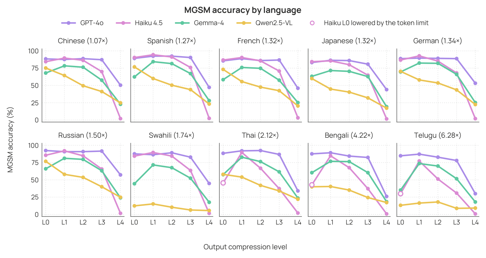

# experiments/

Runners that produce the per-cell `caveman_*.jsonl` generations.

| Script | When to use it |
|---|---|
| `run_experiment.py` | Local HuggingFace models (Qwen2.5-VL-7B, Qwen3.5-9B, DeepSeek-R1-Distill-Qwen-7B, Gemma-4-E4B). Loads weights once and sweeps L0-L4 in one process. |
| `run_experiment_api.py` | API models (`gpt-*`, `claude-*`, Azure deployments tagged via `AZURE_<TAG>_API_KEY`). Reads keys from a `.env` at the repository root. |

Both runners share the same per-record schema and accept the same
`--dataset`, `--condition`, `--level`, `--output_dir` flags. See the
module docstrings for the full CLI.

The shared logic, constraint prompts, dataset loading, input compression,
answer extraction, lives in [`../src/`](../src/) and is imported via a
`sys.path` bootstrap at the top of each runner.

## Open-weight model snapshots

The four open-weight models in the paper use these HuggingFace IDs:

| Tag (`--model_name`) | HuggingFace ID |
|---|---|
| `qwen2.5` | `Qwen/Qwen2.5-VL-7B-Instruct` |
| `qwen3.5` | `Qwen/Qwen3.5-9B-Instruct` |
| `deepseek` | `deepseek-ai/DeepSeek-R1-Distill-Qwen-7B` |
| `gemma4` | `google/gemma-4-e4b-it` |

The tag is the result-tree identifier: it becomes the output directory name and
appears in every generated filename, and the analysis scripts match on it. Use
these exact strings, not the display names from the paper.

Point `run_experiment.py` at a local snapshot of any of these with
`--model_path /path/to/local/weights`. The decoder budget is
`max_new_tokens = {400, 300, 200, 150, 20}` for L0..L4, applied
identically across both channels.

## Extension runners

| Directory | Experiment | Figure |
|---|---|---|
| [`multilingual/`](multilingual/) | MGSM across ten non-English languages plus English. | [ladder](../figures/mgsm_ladder.png) |
| [`longform/`](longform/) | XSum and CNN/DailyMail summarization, Condition B only. | [token flows](../figures/longform_tokens.png) |
| [`size_sweep/`](size_sweep/) | Within-family scale ladder and the thinking-mode contrast. | [sweep](../figures/size_sweep.png) |

MGSM accuracy under output compression, one panel per language, ordered by how
many tokens a question costs relative to English. The two API models keep or
gain accuracy and their cost falls in every language; the open-weight models
split. This is the multilingual version of the "run it on your own setting"
point: the same constraint does not land the same way twice.

## Qwen3-family thinking mode

Pass `--disable_thinking` on any Qwen3-family model. The template emits a
reasoning block unless `enable_thinking` is explicitly `False`, and that
reasoning consumes the decoder budget before an answer is written.

`--enable_thinking` forces it on (the contrast arm). Passing neither leaves the
template untouched, which for Qwen3 also means on.
